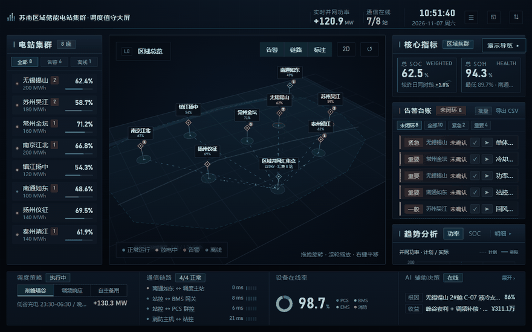

# 储能电站集群 · 数字孪生调度大屏

  

工业值守大屏原型：8 座储能电站集群的「站点列表 → 3D 拓扑 → 指标/告警/趋势」黄金三角布局，纯原生 Canvas 3D 渲染（零三方库），Playwright + PowerShell 回归门禁全程护栏。

## 值守处置闭环（v1.3）

- **告警批量处置**：面板头「批量」进入多选态 → 勾选多条 → 一次确认 / 闭环；批量态用操作条替换筛选行（高度零净增，720p 列表不被挤扁），行内单条按钮收起防误触
- **撤销**：`Ctrl+Z` 回退最近一次处置（处置栈 20 条，单条与批量统一入口），撤销本身也写审计
- **操作审计留痕**：审计抽屉记录「时间 / 角色 / 动作 / 对象 / 结果」，覆盖确认、闭环、批量处置、撤销、策略下发、角色切换；localStorage 留存最近 200 条，菜单项带条数徽标，可导出 CSV
- **边界**：审计为**前端演示态**（浏览器本地存储、可被清空），生产环境需后端审计表 + 账号绑定 + 不可篡改存储（见 `feasibility.md`）

## 演示动图



15 秒真实录制（`tests/tools/demo-gif/` 脚本可复现）：**L0 总览 → Space 暂停 → 告警定位自动下钻到簇 C-07（压差/温度可见）→ 确认 → 闭环 → 批量勾选 2 条闭环（未闭环 8→5）→ Ctrl+Z 撤销（回跳 8）→ A 审计留痕 → C 驾驶舱模式**。

## 免责边界

- 当前版本**仅提供深色主题**（工业值守标准）；浅色报表主题已在设计系统 tokens 中预留扩展位（色彩令牌集中管理），可依据后续需求立项开发
- **v1.2.2 编码事故已结案（v1.3.1）**：`components` / `flow` / `mockups` / `story` 四页中文已全量恢复（778 个缺口逐字判读），`mockups.html` 分层标注渲染正常；恢复方法与会话判定表留档于 `tests/tools/mojibake/`，可复现
- 完整边界声明见 `story.html` §05（版本定位 / 权限 / 审计 / 合规等 7 项）

## 核心差异化：可以被测试的大屏

大多数大屏项目只有截图，没有证据。本项目用底层测试驱动 UI 交付，门禁体系五要素：

| 要素 | 实现 |
|---|---|
| 期望表 | `tests/regression.ps1` 五档视口（1024/1280/1920/2560/3840）实测校准值，容差 ±2~3px |
| 变异背书 | `tests/mutation-checklist.md` 8 项「故意破坏 → 期望红」，证明断言真的能抓错 |
| 失败留痕 | 断言失败自动截图 `tests/artifacts/fail-{w}x{h}.png` + 三段定位（期望/实际/嫌疑规则） |
| 运行证据 | `tests/last-run.txt` 版本 + 时间戳 + 计数归档 |
| 退出码 | 非零失败退出，可挂 CI / pre-commit |

一条命令跑全量：

```powershell
powershell -ExecutionPolicy Bypass -File tests/regression.ps1
```

覆盖：溢出/滚动、字号档位、断点归属、ARIA 角色、密度开关、驾驶舱模式、批量处置与撤销、审计留痕与持久化、console error 清零（61 条断言）。

## 运行

```powershell
python -m http.server 8796   # 根目录起静态服务
# 打开 http://127.0.0.1:8796/index.html
```

## 快捷键

| 键 | 行为 |
|---|---|
| `Esc` | 退出审计 / 退出批量模式 / 上钻一级 / 关闭 AI 抽屉（按优先级） |
| `Space` | 暂停 / 恢复实时刷新 |
| `C` | 驾驶舱模式（投屏态：仅主视图 + 顶栏 KPI，localStorage 记忆） |
| `A` | 打开 / 关闭操作审计抽屉 |
| `Ctrl+Z` | 撤销最近一次告警处置（单条或批量） |

## 版本里程碑

- **v1.3.3** · 深钻态（L3）Tab 文案压到两字（修「明细」被挤出面板）、面板头溢出断言 + 15 秒演示 GIF 录制脚本入仓（断言 79 → 86）
- **v1.3.1** · 四个文档页乱码全量恢复（字节级逆向 + 778 缺口判读），`mockups.html` 内联脚本修复，恢复工具链留档
- **v1.3** · 告警批量处置（多选 / 批量确认 / 批量闭环）、Ctrl+Z 撤销、操作审计留痕（抽屉 + 200 条本地留存 + CSV）、抽屉遮罩统一（修 FAB 层级）
- **v1.2** · 标签屏幕空间碰撞避让（滞后阈值 + 引线 + 优先级）、驾驶舱模式、CSS 缓存治理（link 版本参数）
- **v1.1.x** · 视觉走查三轮：顶栏重构 / 黄金三角信息架构 / 顶栏 KPI 分隔线 / 告警行紧凑制 / SOC 分色进度条 / <13px 清扫 / 快捷键
- **v1.0** · 门禁体系闭环（期望表 + 变异 + 留痕 + 证据 + 退出码）
- **v0.9.x** · 断点体系 / ARIA / 4K 档 / 密度开关 / 特异性治理

完整沿革见 `CHANGELOG.md`；风险登记见 `risk-mitigation.md`；设计规范见 `components.html`。
