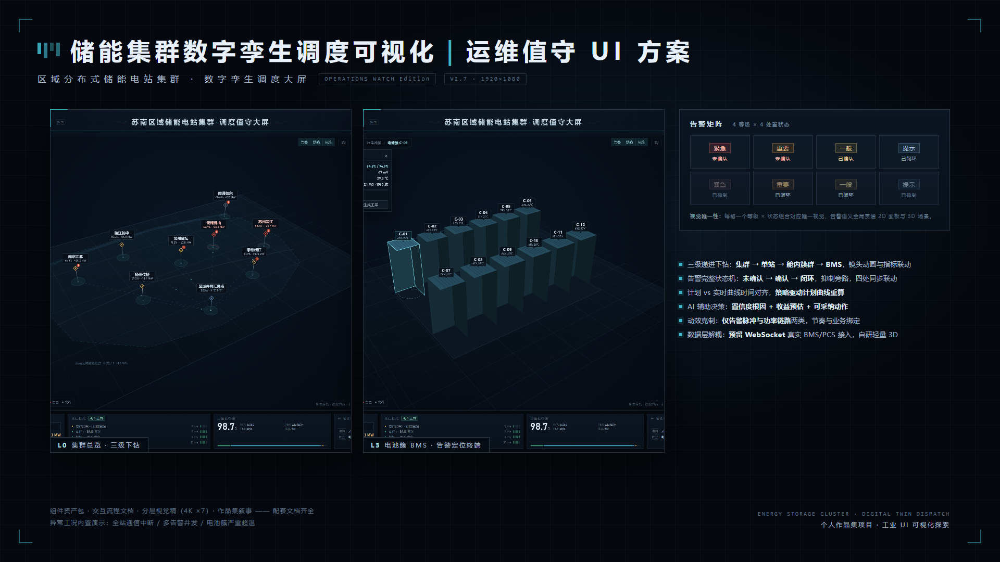
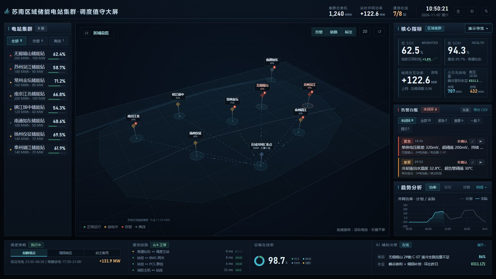
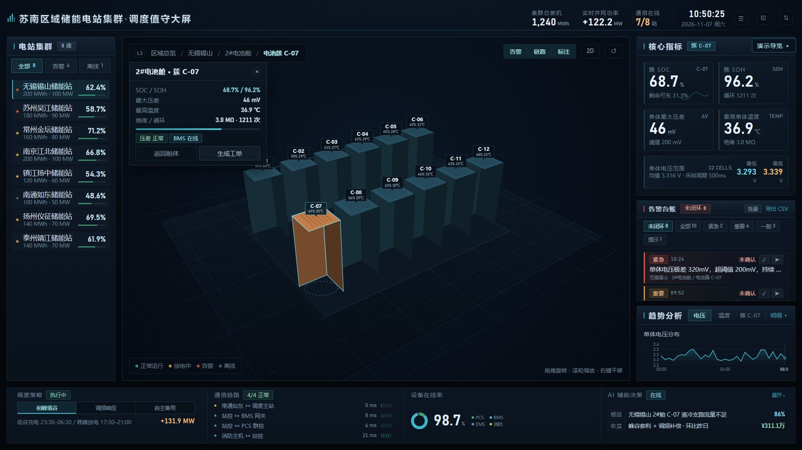
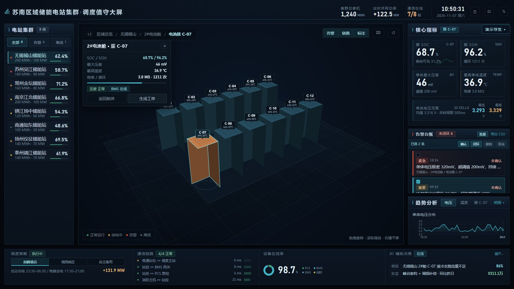
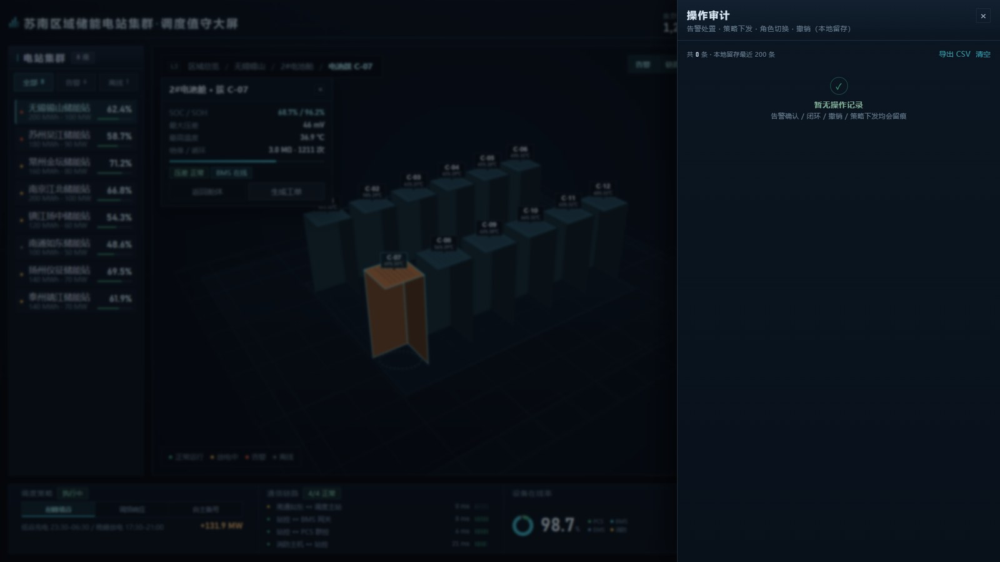
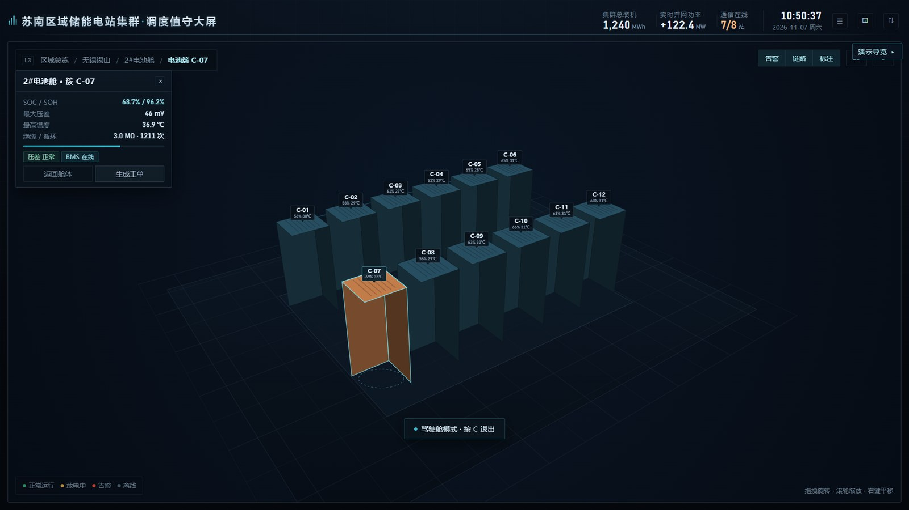
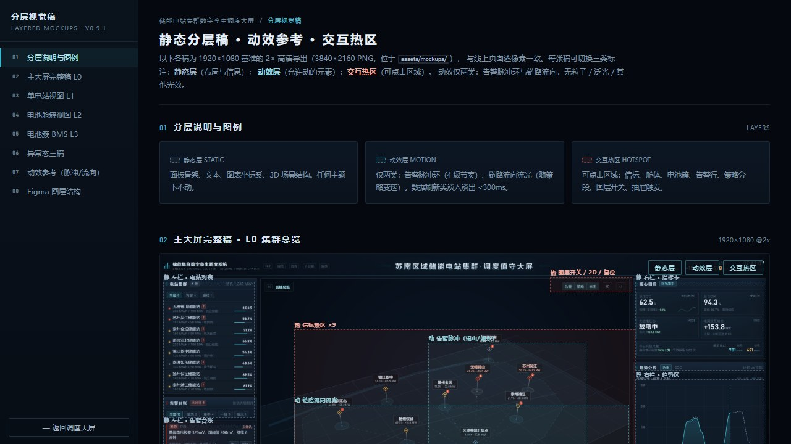
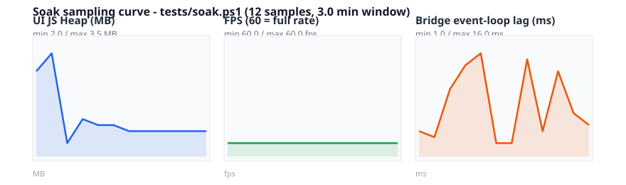
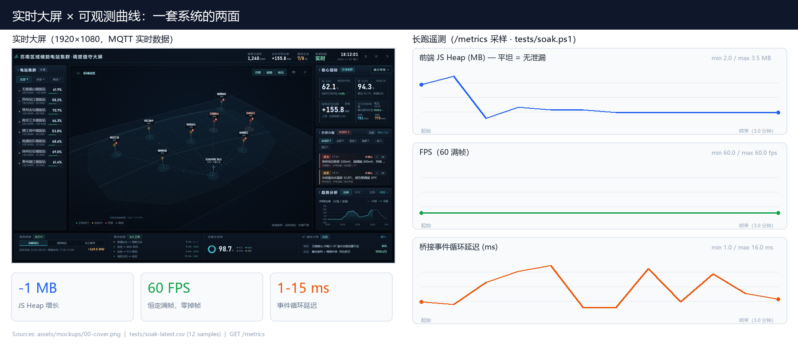
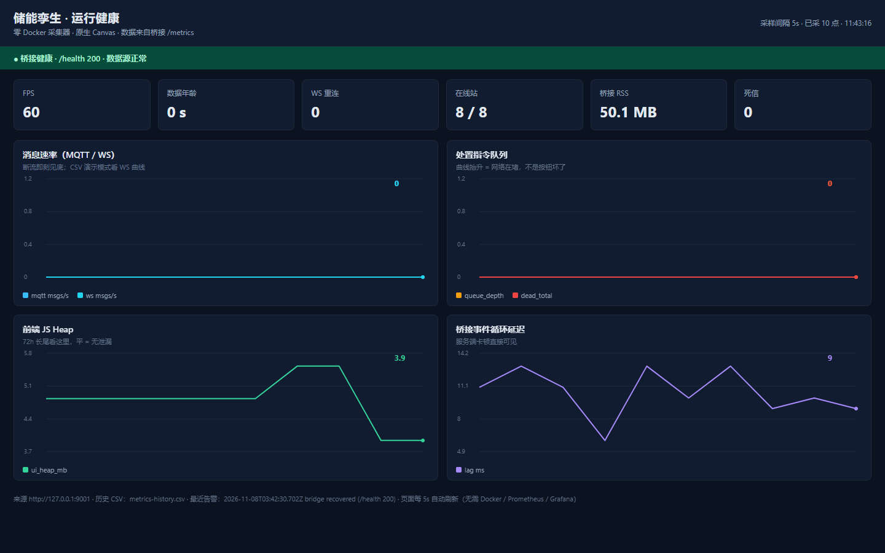

# 储能电站集群 · 数字孪生调度大屏

### 👉 [在线体验 Demo](https://shadow6-a.github.io/energy-storage-twin-dashboard/) （免安装、免注册）

[](https://shadow6-a.github.io/energy-storage-twin-dashboard/)

      

工业值守大屏原型：8 座储能电站集群的「站点列表 → 3D 拓扑 → 指标/告警/趋势」黄金三角布局，纯原生 Canvas 3D 渲染（**零三方库、零构建、零 npm 依赖**），MQTT 直连真实 EMS，Playwright + PowerShell 回归门禁全程护栏。

## 实时数据动图（15 秒，MQTT 驱动）


> 顶栏角标 **「实时」转绿** → 8 站功率/曲线秒级跳动（S06 通信中断被判掉线，在线 7/8）→ 第三方系统经 MQTT 推送一条紧急告警，台账 **未闭环 9→10、紧急 2→3** 秒级同步 → 一键定位下钻到簇 C-07 → 确认回写（落盘 `ops.jsonl` 并发布 `<prefix>/ops` 给 EMS）。
>
> 这与线上 Demo 的静态 mock 是同一份前端——**只差一个 `?ws=live` 参数**。录制：`tests/tools/demo-gif/record-live.ps1` + `compose-live.py`（Playwright 逐帧 + Pillow 合成，无 ffmpeg 依赖）。

## 在线 Demo 的部署方式

纯静态、零构建——**push 即自动发布**（`.github/workflows/deploy-pages.yml`）。之后每次 push `main` 或打 `v*` tag 都会重新部署。

```bash
# 想在自己的机器上跑实时链路（需要 MQTT broker）
node server/bridge.js 9001 --mqtt mqtt://broker.emqx.io:1883 --topic 'ess/#'
node server/mqtt-sim.js --prefix ess          # 无 EMS 时的替身，1Hz 遥测 + 随机告警
# 浏览器：index.html?ws=live   →  角标转绿「实时」
```

## 界面速览

| L0 区域总览（8 站 / 3D 拓扑 / 告警台账 / 趋势） | 告警定位自动下钻到簇 C-07（压差 46mV · 36.9℃） |
|---|---|
|  |  |
| **批量处置**：多选 → 一次闭环，操作条替换筛选行 | **操作审计**：时间 / 角色 / 动作 / 对象 / 结果，可导出 CSV |
|  |  |
| **驾驶舱模式**（`C`）：左右让位，主视图吃满 | **交互稿**：7 张分层稿 + 43 个标注层（`mockups.html`） |
|  |  |

## 值守处置闭环（v1.3）

- **告警批量处置**：面板头「批量」进入多选态 → 勾选多条 → 一次确认 / 闭环；批量态用操作条替换筛选行（高度零净增，720p 列表不被挤扁），行内单条按钮收起防误触
- **撤销**：`Ctrl+Z` 回退最近一次处置（处置栈 20 条，单条与批量统一入口），撤销本身也写审计
- **操作审计留痕**：审计抽屉记录「时间 / 角色 / 动作 / 对象 / 结果」，覆盖确认、闭环、批量处置、撤销、策略下发、角色切换；localStorage 留存最近 200 条，菜单项带条数徽标，可导出 CSV
- **边界**：审计为**前端演示态**（浏览器本地存储、可被清空），生产环境需后端审计表 + 账号绑定 + 不可篡改存储（见 `feasibility.md`）

## 真实数据接入（v2.1：MQTT 直连）

纯前端演示跑 mock；接真实数据**前端零改动**，现场 EMS/BMS 只要有 MQTT 就能上：

```bash
# 1) 桥接：订阅现场 broker，转成大屏 WebSocket 协议
node server/bridge.js 9001 --mqtt mqtt://broker.emqx.io:1883 --topic 'ess/#'
#    带鉴权：--user ems --pass '***'      私有协议前缀：--topic 'plant/1#/#'（默认 ess/#）

# 2) 页面：index.html?ws=live  （或 config.js 里 source:'ws' 永久生效）
```

采集侧只需按约定发报文（`docs/data-contract.md` §4）：

| 主题 | 载荷 | 效果 |
|---|---|---|
| `ess/scada` | `{"stations":[{id,power,soc,soh,temp,status}]}` | 1Hz 指标驱动大屏 + 3D 拓扑着色 |
| `ess/alert` | `{id,lv,st,dev,text}` | 告警即时进台账 |
| `ess/ops` | 桥接**发布**：`{ts,by,action,ids,result}` | 处置回写（确认/闭环/撤销）给 EMS 工单系统 |

- 某站 >12s 无消息自动判掉线（`comm:"offline"`），复通自动恢复，不猜数
- 顶栏「数据链路」角标：灰 `演示数据` / 琥珀 `重连 Ns` / 绿 `实时`（悬停看数据源）
- **没有 EMS 也能自证**：`node server/mqtt-sim.js --prefix ess` 即起一个 1Hz 遥测 + 随机告警的 EMS 替身

自带桥接（`server/bridge.js` + 手写 MQTT 3.1.1 客户端，**零 npm 依赖**），端到端护栏：`tests/live_e2e.ps1`（WS 链路 9 断言）、`tests/mqtt_e2e.ps1`（MQTT 链路 10 断言）。

## 工程化监控（v2.2：不只是「能看」）

桥接进程自带 Prometheus 指标端点与降级探活，前端遥测回传聚合——出问题是「有指标可查」而不是「两眼一抹黑」：

```bash
curl http://127.0.0.1:9001/metrics   # Prometheus text format，直接抓取
curl http://127.0.0.1:9001/health    # 数据源死寂>30s → 503 + reasons[]（可联动告警）
```

| 指标组 | 内容 |
|---|---|
| 数据面 | `ess_mqtt_msgs_total / _rate / _dropped_total`、`ess_mqtt_connected`、`ess_stations_online` |
| 控制面 | `ess_ops_writeback_ms`（回写落盘耗时）、`ess_ops_retry_total / _queue_depth / _dead_total`（投递重试与死信） |
| 进程面 | `ess_bridge_heap_mb / _rss_mb / _eventloop_lag_ms`、`ess_uptime_seconds` |
| 前端遥测 | `ess_ui_fps`、`ess_ui_heap_mb`、`ess_ui_reconnects`、`ess_ui_last_data_age_seconds` |

**反向控制闭环（outbox 模式）**：处置指令先落盘审计（不可丢），MQTT 投递失败自动重试（2s×5）；终态 `opAck` 帧回前端——**投递失败时 UI 自动回滚本地状态并 toast 明示**，绝不静默丢指令。真实 BMS 的 NaN / 超量程坏点在摄取入口被合理性闸门拦截。

### 混沌工程（v2.3：对数据链路下狠手）

```powershell
# 乱序迟到旧数据（每 6s 补发 10s 前快照）+ 每 25s 强拆 MQTT 链路 5s
node server/mqtt-sim.js --prefix ess --chaos reorder
node server/bridge.js 9001 --mqtt ... --topic ess/# --chaos-flap 25
powershell -ExecutionPolicy Bypass -File tests/chaos_e2e.ps1   # 12 断言
```

实测结论：迟到旧数据被**入口拒收**（`ess_mqtt_msgs_stale_total` 可见），断链窗口内处置指令**有界排队**（depth=1，无风暴）、退避上限 30s 内重连、恢复后**队列收敛到 0**（最终一致）、UI 数据年龄全程 <12s、零死信、功率值从未被旧数据污染。

**72h 长跑采样曲线**（真实 soak 数据，heap 平坦 = 无泄漏迹象）：



**并排头图**（大屏截图 × 可观测曲线，发布 / 汇报用一张图说清「能看 + 能管」）：



### Prometheus + Grafana（一键联动）

```bash
cd deploy && docker compose up -d
# Prometheus http://localhost:9090（5s 抓取桥接 /metrics）
# Grafana    http://localhost:3000（预置「运行健康」仪表盘：速率/队列/Heap/Lag 四联曲线）
```

**无 Docker 等价方案**（下载不了 Docker / 内网隔离时，零安装、零外部依赖，只用 Node）：

```powershell
powershell -ExecutionPolicy Bypass -File deploy/nodocker/start.ps1
# 打开 http://127.0.0.1:9099/ （四联曲线仪表盘）与 http://127.0.0.1:8931/index.html?ws=live（大屏遥测源）
```

`deploy/nodocker/collector.js` 定时抓桥接 `/metrics` + `/health`，内存滚动窗口 + `metrics-history.csv` 落盘，自带原生 Canvas 仪表盘（消息速率 / 队列深度 / JS Heap / 事件循环延迟）、6 张指标卡、`/api/series` JSON 接口；`/health` 非 200 立即红条告警并写 `alerts.log`，恢复后记 recovered。**不需要 Docker、Prometheus、Grafana，也不需要联网下载任何东西**——有 Docker 时 `deploy/docker-compose.yml` 仍可用。



**长跑与故障演练**（72h 无人值守的护栏）：

```powershell
powershell -ExecutionPolicy Bypass -File tests/fault_inject.ps1   # kill 数据源→掉线→health 降级→恢复，9 断言
powershell -ExecutionPolicy Bypass -File tests/soak.ps1 -Minutes 1440   # 24h 内存/FPS/延迟采样，堆增长超限自动失败
```

### 内网 / 现场部署（隔离环境）

```powershell
# ① 整套静态站一键部署（详见 deploy/static/push.ps1）
powershell -ExecutionPolicy Bypass -File deploy/static/push.ps1 -Target <内网IP> -User root -Key <密钥>

# ② 内网隔离演练：拔网线 → 秒切本地推演 → 恢复平滑过渡（零外网依赖）
powershell -ExecutionPolicy Bypass -File tests/link_drill.ps1            # 10 断言
powershell -ExecutionPolicy Bypass -File tests/link_drill.ps1 -Manual     # 无浏览器自动化时的人工检查点

# ③ 混沌演练指向内网 broker（默认脚本用公网 broker，隔离环境必须改）
powershell -ExecutionPolicy Bypass -File tests/chaos_e2e.ps1 -MqttUrl mqtt://<内网broker>:1883
```

**接真实 WS**：前端 `?ws=live` 自动推导同域 `/ws`（https 自动 wss），把 `deploy/static/nginx-ws.conf.example` 放到 nginx 配置即可，前端零改动。关键补齐项是 `proxy_read_timeout 3600s`——默认 60 秒会掐断 WS 长连接。断链时角标转琥珀「重连 Ns」、本地推演继续抖动，恢复后按实际 URL 重连（**不会退回 `127.0.0.1:9001` 默认值**）。

## 免责边界

- 当前版本**仅提供深色主题**（工业值守标准）；浅色报表主题已在设计系统 tokens 中预留扩展位（色彩令牌集中管理），可依据后续需求立项开发
- **v1.2.2 编码事故已结案（v1.3.1）**：`components` / `flow` / `mockups` / `story` 四页中文已全量恢复（778 个缺口逐字判读），`mockups.html` 分层标注渲染正常；恢复方法与会话判定表留档于 `tests/tools/mojibake/`，可复现
- 完整边界声明见 `story.html` §05（版本定位 / 权限 / 审计 / 合规等 7 项）

## 核心差异化：可以被测试的大屏

大多数大屏项目只有截图，没有证据。本项目用底层测试驱动 UI 交付，门禁体系五要素：

| 要素 | 实现 |
|---|---|
| 期望表 | `tests/regression.ps1` 五档视口（1024/1280/1920/2560/3840）实测校准值，容差 ±2~3px |
| 变异背书 | `tests/mutation-checklist.md` 8 项「故意破坏 → 期望红」，证明断言真的能抓错 |
| 失败留痕 | 断言失败自动截图 `tests/artifacts/fail-{w}x{h}.png` + 三段定位（期望/实际/嫌疑规则） |
| 运行证据 | `tests/last-run.txt` 版本 + 时间戳 + 计数归档 |
| 退出码 | 非零失败退出，可挂 CI / pre-commit |

一条命令跑全量：

```powershell
powershell -ExecutionPolicy Bypass -File tests/regression.ps1
```

覆盖：溢出/滚动、字号档位、断点归属、ARIA 角色、密度开关、驾驶舱模式、批量处置与撤销、审计留痕与持久化、console error 清零（61 条断言）。

## 运行

```powershell
python -m http.server 8796   # 根目录起静态服务
# 打开 http://127.0.0.1:8796/index.html
```

## 快捷键

| 键 | 行为 |
|---|---|
| `Esc` | 退出审计 / 退出批量模式 / 上钻一级 / 关闭 AI 抽屉（按优先级） |
| `Space` | 暂停 / 恢复实时刷新 |
| `C` | 驾驶舱模式（投屏态：仅主视图 + 顶栏 KPI，localStorage 记忆） |
| `A` | 打开 / 关闭操作审计抽屉 |
| `Ctrl+Z` | 撤销最近一次告警处置（单条或批量） |

## 版本里程碑

- **v2.0.0** · 真实数据链路：DataIO WS 客户端（重连/心跳/角标/处置回写）+ 零依赖桥接服务 + 协议契约文档 + 实时链路 E2E（9 断言）
- **v1.3.3** · 深钻态（L3）Tab 文案压到两字（修「明细」被挤出面板）、面板头溢出断言 + 15 秒演示 GIF 录制脚本入仓（断言 79 → 86）
- **v1.3.1** · 四个文档页乱码全量恢复（字节级逆向 + 778 缺口判读），`mockups.html` 内联脚本修复，恢复工具链留档
- **v1.3** · 告警批量处置（多选 / 批量确认 / 批量闭环）、Ctrl+Z 撤销、操作审计留痕（抽屉 + 200 条本地留存 + CSV）、抽屉遮罩统一（修 FAB 层级）
- **v1.2** · 标签屏幕空间碰撞避让（滞后阈值 + 引线 + 优先级）、驾驶舱模式、CSS 缓存治理（link 版本参数）
- **v1.1.x** · 视觉走查三轮：顶栏重构 / 黄金三角信息架构 / 顶栏 KPI 分隔线 / 告警行紧凑制 / SOC 分色进度条 / <13px 清扫 / 快捷键
- **v1.0** · 门禁体系闭环（期望表 + 变异 + 留痕 + 证据 + 退出码）
- **v0.9.x** · 断点体系 / ARIA / 4K 档 / 密度开关 / 特异性治理

完整沿革见 `CHANGELOG.md`；风险登记见 `risk-mitigation.md`；设计规范见 `components.html`。
